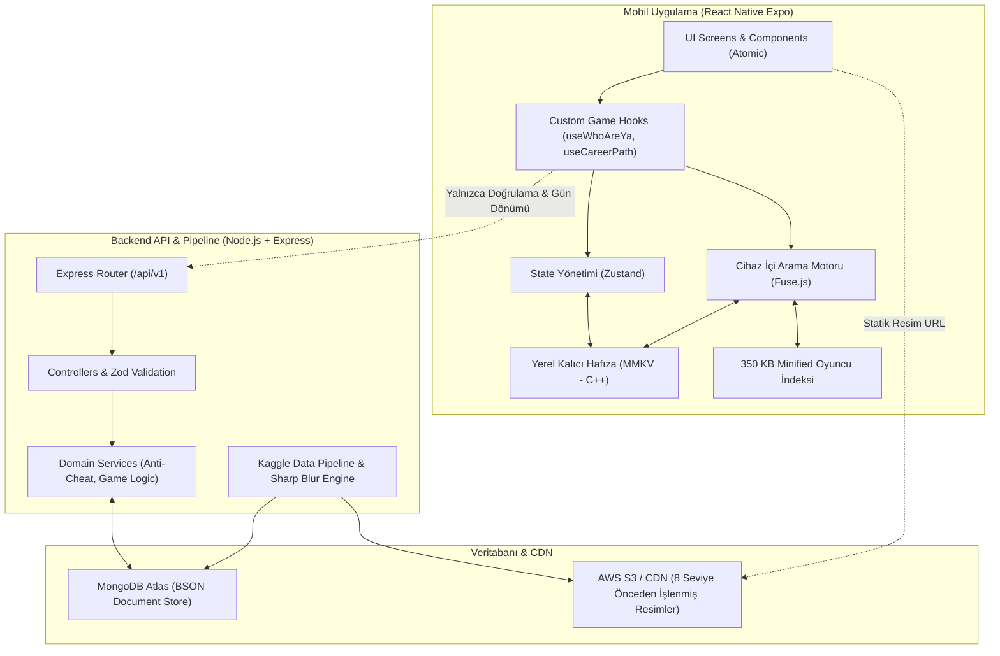

# Penalty Mobile Game Hub - Sistem Mimarisi ve Teknik Dokümantasyon

Bu doküman, Teknopark ön kuluçka sürecinde geliştirilen **Penalty** mobil futbol oyun portalının ölçeklenebilir, yüksek performanslı ve "Thick Client, Thin Server" mimari prensiplerine dayalı teknik altyapısını açıklamaktadır.

---

## 1. Genel Sistem Mimarisi (Thick Client, Thin Server)

Mobil oyunlarda kullanıcı deneyimini doğrudan bozan en büyük problem ağ gecikmesidir (latency) ve yüksek eşzamanlı kullanıcı (CCU) anlarında sunucunun darboğaza girmesidir. Bu sorunu kökten çözmek için mimarimiz **İstemci tarafında ağır, Sunucu tarafında hafif** kuralıyla tasarlanmıştır.



---

## 2. Dört Kritik Mimari Kural ve Çözümleri

### A. Otomatik Tamamlama (Arama) Darboğazı Önlemi
- **Problem:** Kullanıcı arama kutusuna her harf yazdığında backend'e istek atılırsa 10.000 aktif kullanıcıda Node.js sunucusu saniyeler içinde kilitlenir.
- **Mimari Çözüm:** 
  1. Süper Lig ve 5 Büyük Lig'deki ~3.500 oyuncunun yalnızca `id, name, nationality, club, league, position` bilgilerini içeren minified bir JSON dosyası (~350 KB) üretilir (`backend/src/scripts/exportSearchIndex.ts`).
  2. Uygulama ilk açılışta veya güncelleme geldiğinde bu paketi indirip MMKV içine kaydeder.
  3. Arama işlemi mobil cihazın kendi işlemcisinde `Fuse.js` ile **tamamen internetsiz (offline)** ve <2ms sürede gerçekleşir. Sıfır sunucu yükü!

### B. Bulanık Resim (Blur) RAM Maliyeti Önlemi
- **Problem:** React Native içinde runtime'da resme blur filtresi uygulamak eski telefonların RAM'ini tüketir ve bataryayı hızlı bitirir.
- **Mimari Çözüm:**
  - Futbolcu fotoğrafları backend tarafında `sharp` kütüphanesiyle önceden 8 farklı seviyede bulanıklaştırılır (`level_1.webp` en bulanık, `level_8.webp` kristal net).
  - Mobil cihaza yalnızca resmin statik URL'si verilir. Mobil cihaz sadece standart resim render eder, hiçbir grafik filtreleme işlemi çalıştırmaz.

### C. Günlük Veri (Daily Data) Hile Önlemi (Anti-Cheat)
- **Problem:** Kullanıcıların cihaz saatini ileri alarak yarının bulmacasını çözmesi.
- **Mimari Çözüm:**
  - Günlük oyunların geçerliliği asla cihaz saatine (Client Time) bırakılmaz.
  - Backend `/api/v1/system/time` endpoint'i üzerinden sunucu saatini (UTC) otorite kabul eder. Gece 00:00:00 UTC baz alınarak gün dönümü hesaplanır.

### D. Çevrimdışı (Offline-First) Oynanabilirlik
- **Problem:** İnternet koptuğunda uygulamanın çökmesi veya oynanamaması.
- **Mimari Çözüm:**
  - Kariyer (Level) paketleri önceden yerel cihaza indirilebilir (`levelApi.getLevelPack`).
  - Metroda veya uçaktayken de leveller kesintisiz oynanabilir. Reklam gösterimi ve skor kaydı internet bağlandığında arka planda senkronize edilir.

---

## 3. Veritabanı ve Şema Yapısı (MongoDB)

### `Player` Koleksiyonu
```typescript
{
  playerId: "tmid_12345",
  name: "Mauro Icardi",
  leagues: ["super_lig", "serie_a", "ligue_1"],
  currentClub: {
    id: "club_galatasaray",
    name: "Galatasaray",
    logoUrl: "https://assets.penaltyhub.com/clubs/galatasaray.png",
    league: "super_lig"
  },
  nationality: "Argentina",
  position: "CF",
  age: 33,
  shirtNumber: 9,
  careerPath: [
    { clubName: "Sampdoria", startYear: 2011, endYear: 2013, apps: 33, goals: 11 },
    { clubName: "Inter", startYear: 2013, endYear: 2019, apps: 219, goals: 124 },
    { clubName: "Paris Saint-Germain", startYear: 2019, endYear: 2022, apps: 92, goals: 38 },
    { clubName: "Galatasaray", startYear: 2022, apps: 75, goals: 55 }
  ],
  blurImages: [
    "https://assets.penaltyhub.com/blurred/icardi/level_1.webp",
    "...",
    "https://assets.penaltyhub.com/blurred/icardi/level_8.webp"
  ],
  isActive: true
}
```

### `DailyChallenge` Koleksiyonu
- Bileşik benzersiz indeks: `{ date: 1, gameMode: 1, leagueMode: 1 }` (Her gün, her oyun ve her lig modu için tam olarak bir resmi soru).

---

## 4. Dizin Yapısı (SOLID & Decoupled)

```
penalty/
├── backend/
│   ├── src/
│   │   ├── config/           # Database bağlantısı, tip-güvenli Zod ENV, sabitler
│   │   ├── controllers/      # İstek yönlendirme ve HTTP yanıt yönetimi
│   │   ├── middlewares/      # Zod doğrulama, global hata yakalayıcı (AppError)
│   │   ├── models/           # Mongoose şemaları (Player, DailyChallenge, Level, Club)
│   │   ├── routes/           # Express route tanımları (/players, /daily, /levels, /system)
│   │   ├── services/         # İş mantığı, Wordle karşılaştırma algoritması, anti-cheat
│   │   ├── scripts/          # Kaggle CSV streaming parser, 8-level blur üretici, seed
│   │   ├── app.ts            # Express konfigürasyonu (Helmet, Compression, CORS)
│   │   └── server.ts         # Server dinleyici ve Graceful Shutdown
│   ├── package.json
│   └── tsconfig.json
│
├── mobile/
│   ├── src/
│   │   ├── api/              # Axios istemcisi, Android emulator IP desteği
│   │   ├── assets/           # Minified 350KB arama indeksi ve grafikler
│   │   ├── features/         # Feature-Driven Mimari
│   │   │   ├── whoAreYa/     # Scout Raporu (Bulanık resim & Wordle karşılaştırma)
│   │   │   ├── careerPath/   # Transfer Rotası (Kronolojik kariyer timeline)
│   │   │   ├── daily/        # Günün sorusu UTC geri sayım kartı
│   │   │   ├── search/       # Cihaz içi Fuse.js fuzzy arama modalı ve item'ları
│   │   │   └── monetization/ # Ödüllü video reklam entegrasyonu (HintWithAd)
│   │   ├── screens/          # HomeScreen, WhoAreYaScreen, CareerPathScreen
│   │   ├── storage/          # C++ MMKV sarmalayıcısı (Şifreli ve hızlı)
│   │   ├── stores/           # Zustand oyun ve ayarlar store'ları
│   │   └── theme/            # Renkler, boşluklar, tipografi (Stadyum karanlık tema)
│   ├── package.json
│   ├── app.json
│   └── App.tsx
└── docs/
    └── ARCHITECTURE.md
```

---

## 5. Kurulum ve Çalıştırma Rehberi

### Backend'i Başlatma
1. `cd backend`
2. `.env` dosyasını kontrol edin.
3. Test ve demo verilerini tohumlamak için:
   ```bash
   npm run pipeline:seed-demo
   ```
4. Geliştirme sunucusunu başlatın:
   ```bash
   npm run dev
   ```
5. Endpoint testleri:
   - Sağlık Kontrolü: `GET http://localhost:5000/api/v1/system/health`
   - Otoriter UTC Saat: `GET http://localhost:5000/api/v1/system/time`
   - Hafif Oyuncu İndeksi: `GET http://localhost:5000/api/v1/players/search-index`

### Mobil Uygulamayı (Expo) Başlatma
1. `cd mobile`
2. Bağımlılıkları yükleyin:
   ```bash
   npm install
   ```
3. Expo uygulamasını başlatın:
   ```bash
   npm run start
   ```
4. Android, iOS veya Web üzerinde anında test edin (`npm run web` / `npm run android`).
